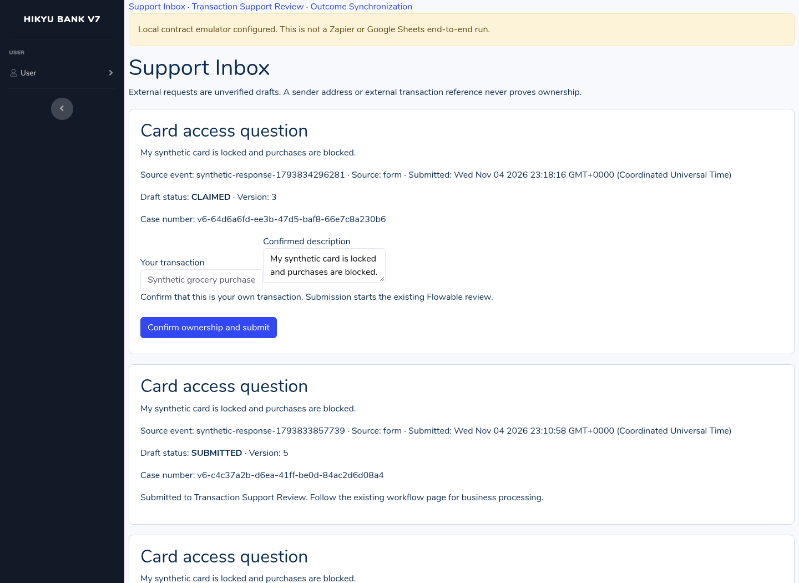
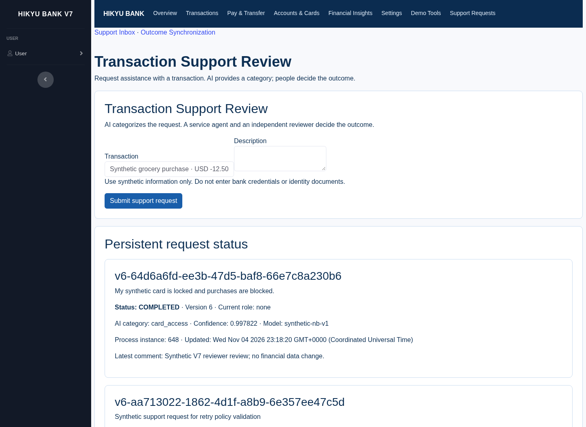
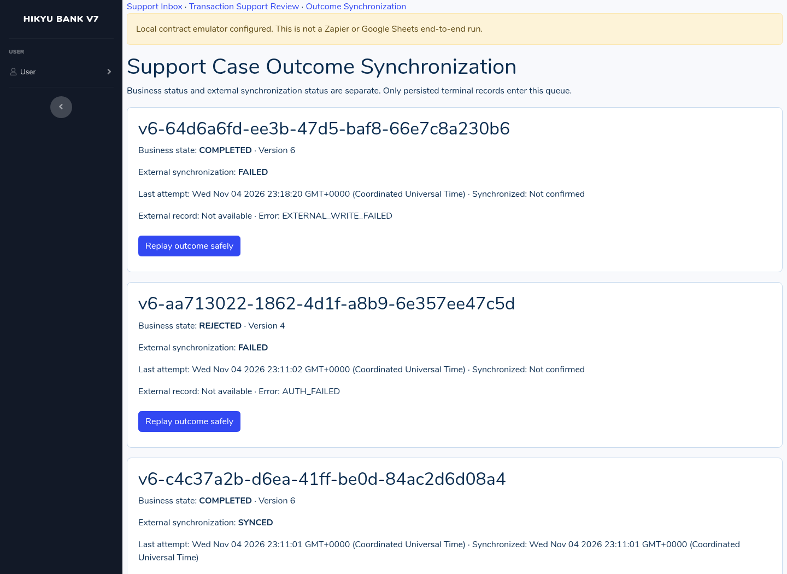
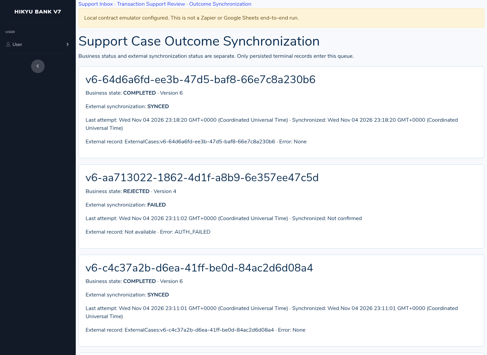

# Hikyu Bank V7 — External Integration Assignment

Date: November 4, 2026. Baseline: the newly supplied `Version6_MingyuFan.zip` only. Delivery status: **local V7 implementation verified; real Zapier/Google end-to-end acceptance blocked pending owner configuration and execution**. No historical V6 result is counted as a V7 result.

## Step 1 — Integration platform and verified baseline

Zapier is the required external integration platform. Its event/action editor and reusable authenticated connections fit two narrowly scoped integrations without replacing Flowable. Saltcorn remains the application and PostgreSQL remains the authoritative business store. Flowable remains responsible for the existing Transaction Support Review, including classification and human decisions. Zapier does not decide banking outcomes or change transactions or balances.

The uploaded archive contains a V6 report PDF and a nested source archive. Inspection confirmed Saltcorn 1.6.2, PostgreSQL 17, a Flowable 7.1.0 Java service, a local trained Naive Bayes classifier, native support views, server-side ownership checks and persistent workflow projections. The report describes eight pages and sixteen tables. V7 adds two pages and five integration tables. Fresh native-session tests confirmed support submission, actual classifier execution, agent-to-reviewer handoff, owner isolation and terminal write-back. The V6 BPMN and financial logic are retained; runtime paths, ports and fresh installation identities were relocated for isolation.

The independent working directory is `work/`. The original uploaded archive has SHA-256 `27db1ede1fcc8ee21cc9d4890bf6cfa0d14368d6e34affd617c14b058413b13a`. It is retained separately in the delivery. Uploaded historical evidence is not presented as current proof.

### Actual plan and capability evidence

| Capability | Current evidence | V7 consequence |
|---|---|---|
| Account plan | Owner reports Free | No purchase, upgrade or trial was started |
| Code by Zapier / Run Javascript | Owner reports allowed without upgrading | Not required by the final secure design |
| Private integration creation and use | Owner reports allowed on this account | Deliver a private integration using authenticated connection fields |
| Two-step Zaps | Designed as one trigger and one action each; not activated in this session | Must verify both Zaps remain enabled on Free before acceptance |
| Google Sheets trigger | Selected, not connected or run here | Owner must authorize a newly created synthetic spreadsheet |
| Webhooks / premium connectors / extra Formatter steps | Not relied upon; current entitlement not verified | Custom authenticated actions and the relay perform processing in one action |
| Task allowance, polling frequency and history retention | Not independently verified | Capture the actual account limits before running; do not assume a quota or retention period |
| Automatic replay and custom retry controls | Not verified on Free and not claimed | Application outbox retries transient transport errors; staff can create a fresh delivery generation |
| Local SDK validation | Official SDK/CLI 19.3.0 installed from npm; structural validation passed | This validates configuration structure, not cloud execution |

Official pricing, help, platform documentation and the supplied Canvas assignment URL were attempted on November 4, 2026. The managed network proxy returned 403 before retrieval. Their contents and the complete current Free entitlement matrix could not be verified. The owner confirmations above are explicitly distinguished from official verification. See `evidence/official-retrieval-current.json`. No fully free, deployed, working combination is claimed. Google account, Apps Script quotas and hosting eligibility remain account-specific. Self-hosted PostgreSQL/Flowable and local classification need compute/storage even without a subscription or external AI API fee.

## Step 2 — Two integration use cases

### External Support Request Intake

A new synthetic Google Form is captured by an owner-authorized Apps Script installable submission trigger. `FormResponse.getId()` supplies a stable response ID; the new form ID supplies a namespace. The script appends a row to the new `SourceEvents` sheet. Zap 1, **Hikyu V7 - External Support Request Intake**, uses Google Sheets / New Spreadsheet Row and the private integration action / Stage External Support Draft.

The action maps only `source_type`, `source_namespace`, `source_event_id`, `subject`, `description`, `submitted_at` and optional `source_reference`. It trims text, validates required values and lengths, requires a timezone-qualified valid calendar timestamp, and converts it to UTC ISO 8601. The relay and application independently validate the same contract. External owner IDs and transaction-binding fields are rejected. The authenticated relay queues the request; the local worker pulls it into `support_inbox` and acknowledges only after the database commit. A lost acknowledgement can be retried without another draft because the source tuple has a unique database index. Reusing that tuple with different content is a conflict.

This reduces duplicate entry while retaining a necessary trust boundary. A sender address, form content or external transaction reference is never authentication. Only authorized staff see unassigned drafts and assign them to a configured requester. The assigned requester signs in, claims the draft and selects a transaction from their own records. Server-side validation repeats the ownership check. Only that explicit confirmation calls the unchanged V6 submit function. A draft alone never starts Flowable.

### Support Case Outcome Synchronization

The V7 worker scans committed `support_requests` rows in `COMPLETED` or `REJECTED` and captures a durable outbox event. It never publishes directly from a browser message or an uncommitted Flowable variable. Zap 2, **Hikyu V7 - Support Case Outcome Synchronization**, uses the private integration polling trigger / New Persisted Terminal Support Outcome and action / Upsert External Support Outcome.

The exchange contains only delivery ID, stable business case number, final state, state version and processing timestamp. It excludes request body, transaction ID, account identifiers, balances and classifier details. The action causes the authenticated relay to upsert the new spreadsheet's `ExternalCases` table by case number and persist a receipt. The worker pulls the receipt and updates `v7_case_sync`; the application shows business state and external synchronization separately. The external table provides team visibility of outcomes without becoming a competing business database. An external failure never reverses the committed business outcome.

## Step 3 — Implementation and design decisions

```text
New Google Form -> SourceEvents sheet -> Zap 1 -> signed relay intake queue
                                                      |
                                        local worker pulls/commits/acks
                                                      v
Saltcorn Support Inbox -> staff assign -> requester claims and selects own transaction
                                                      |
                                              existing Flowable
                                      classifier -> agent -> reviewer/other paths
                                                      |
                                        committed Saltcorn terminal state
                                                      v
PostgreSQL outbox -> signed relay outcome queue -> Zap 2 -> ExternalCases upsert
                                                      |
                                      durable receipt -> worker -> V7 sync UI
```

The application binds only to loopback, with Saltcorn at port 8197, Flowable at 8196 and a separate PostgreSQL mapping at 55476 for this installation. Localhost is not represented as a Zapier endpoint. Only the restricted relay is a candidate public HTTPS web app. It requires signed requests; it exposes no Saltcorn login, database or administration page. Actual Google deployment and connectivity have not occurred here.

### Data, correlation and roles

| Object | Responsibility and key |
|---|---|
| `support_inbox` | Unverified source content, assignment, claim, frozen confirmed transaction/description, draft version and support link; unique source type/namespace/event ID |
| Existing `support_requests` | Authoritative business case, native owner/transaction, Flowable process ID, stage, AI projection and sequence |
| `v7_outbox` | One immutable terminal snapshot per case/version, delivery generation, attempts and transport state |
| `v7_case_sync` | Separate external synchronization state for the current case version |
| `v7_receipts` | Durable deduplication and correlation of relay receipts |
| `v7_audit` | Correlation ID, operation, result code, actor and time; no credentials or full payloads |
| Relay queues / `ExternalCases` | Delivery bookkeeping and a minimal derived outcome projection; never banking truth |

The existing `v6-<UUID>` business key convention is deliberately retained because the existing submit function validates it. The prefix is not a version claim. Native row ID, business key, source response ID, Flowable instance ID, outcome event ID and replay delivery ID are distinct and explicitly linked.

All roles are freshly generated synthetic accounts in this independent installation. `service_agent`, `supervisor` and the native builder can assign/replay. `requester` and `other_requester` can claim only assigned drafts and submit only their own transactions. The original reviewer/service/supervisor/requester task permissions remain in Flowable and the existing adapter. Native tables restrict writes to administrator code; requester draft reads are owner-scoped, and custom pages independently enforce role and ownership. Testing uses one operator switching independent native sessions, not real multiple participants.

### State and interface contracts

Draft transitions are `NEW -> ASSIGNED -> CLAIMED -> SUBMITTING -> SUBMITTED`. Staff may reassign before claim. Submission errors or an interrupted confirmation older than two minutes enter `SUBMISSION_FAILED`; retry uses the frozen transaction and description and the same business key. Draft version checks reject concurrent stale edits. Existing business states remain `SUBMITTED`, `MANUAL_TRIAGE`, `SERVICE_REVIEW`, `RETURNED`, `REVIEWER_REVIEW`, `ESCALATED`, `COMPLETED` and `REJECTED` under the existing adapter.

Transport states are independent: `PENDING`, `RETRY_PENDING`, `WAITING_ZAPIER`, `FAILED`, `SYNCED`, or `STALE_REMOTE_VERSION` in the case projection, with corresponding outbox states including `ACKNOWLEDGED` and `OBSOLETE`. Publishing alone never means synchronized. Only a matching durable receipt confirms success.

All relay calls are POSTs with `{client,timestamp,nonce,body,signature}`. `body` is the exact JSON text `{operation,payload}`. HMAC-SHA256 signs `client + newline + timestamp + newline + nonce + newline + body`. Separate app/Zapier secrets, a five-minute timestamp window, persistent nonces and explicit operation allowlists limit replay and privilege. Apps Script ContentService uses HTTP 200 with `{ok:true,data}` or `{ok:false,error:{status,code,retryable}}`; clients inspect the envelope rather than treating HTTP 200 alone as success. Application client timeouts are 15 seconds.

The application key can pull/ack intake, publish outcomes and pull/ack receipts. The Zapier key can stage intake, poll outcomes, apply published outcomes and test the connection. Zapier cannot fabricate a published business outcome using its key. Secrets reside only in the local private configuration, Apps Script Properties and Zapier's password-type connection field. They are not Zap step inputs. No long-lived secret is embedded in a Code step, frontend, screenshot or exported project.

### AI and LCNC scope

An AI coding assistant helped inspect the uploaded implementation, design the integration boundaries and produce implementation/configuration files. Zapier AI-assisted builder and Zapier runtime AI were **not used**. The actual runtime AI remains V6's local classifier invoked within Flowable; fresh tests observed `card_access`. It assists routing, not financial approval. No external AI API, real identity information or banking data was submitted. The existing model's low-confidence/failure branches remain under human control; not every AI failure branch was retested through V7.

Saltcorn's native page/view/table APIs make the new UI and schema visible in the LCNC application. The authorization, HMAC, idempotency and relay behavior require coded extensions. Compared with hand-coded V6 extensions, the Zap editor can expose mappings, but the safe asynchronous boundary needs explicit versions and receipts. Local structural validation is easier than proving a cloud connection; browser sessions, database queries and workflow execution were needed to verify behavior.

## Step 4 — Errors, monitoring and recovery

Invalid input is rejected with 400/422 semantics; a conflicting reused source ID gives 409; authentication or role errors give 401/403. No invalid draft is committed. Transient network/HTTP 408/425/429/5xx errors are retryable. Outbox publication uses bounded exponential delays and a six-attempt budget. Permanent errors are not automatically resubmitted. A persistent worker circuit breaker pauses permanent configuration/authentication failures until configuration changes or an operator explicitly resumes it; transient polling failures back off to at most one minute.

The relay serializes operations with a script lock. External rows are keyed by case ID. A lower version is ignored, an equal matching version is idempotent, an equal conflicting version is rejected, and only a higher version can replace the projection. An applied delivery is not duplicated. After a failed write, the staff replay action creates a new delivery generation while retaining the same case/version. This avoids relying on paid automatic replay or a polling trigger accepting an already deduplicated delivery ID. Late superseded receipts and late failures cannot overwrite acknowledged success.

A real local HTTP connection refusal was reproduced and recovered. A controlled failure in the delivered Apps Script code, running against emulated Google storage, produced `EXTERNAL_WRITE_FAILED`, a V7 `FAILED` sync state and an unchanged `COMPLETED` business state. Staff replay then produced one external emulator row and a confirmed receipt after refresh. This proves the local contract and recovery implementation; it is **not** evidence of a failed/recovered Zapier cloud run.

Staff monitor `/page/case-synchronization`, the safe audit list and private transport state. The relay has minimal `Audit` metadata. In Zapier, use Zap History / the individual run's failed step and correlation fields, subject to the actual Free history controls. No history retention, automatic replay or execution metric unavailable in this account is claimed. Capture live run IDs and timestamps only when the owner actually executes the Zaps.

## Step 5 — Verification and delivery

Fresh V7 results: **17 local integration checks passed**, including real Saltcorn sessions, PostgreSQL persistence, actual Flowable/classifier, ownership isolation, idempotency, failure/replay and unchanged account/transaction snapshots. The delivered Zapier functions were executed locally with intercepted transport, not in the Zap editor. Fresh V6 support UI regression passed 8 checks; workflow HTTP regression passed 9 tests; Flowable engine build tests passed 6 during independent setup. Official CLI structural validation passed; online platform checks were blocked.

The test report records prerequisites, steps, expected/actual results, artifacts and separate live acceptance rows. Real Google Form -> Zapier -> V7 intake, full outbound Zapier synchronization, real Zap failure/recovery, actual Free limits and real multi-person testing remain blocked or not tested. No Zap IDs, screenshots or successful deployments are invented.



Figure 1. Fresh local Saltcorn UI, native requester session. The visible warning identifies the local relay emulator. All data is synthetic.



Figure 2. Existing Flowable process reached completion and the same Saltcorn case persisted after refresh; one operator simulated different roles.



Figure 3. Actual V7 UI after the controlled write failure in the delivered relay code running with emulated Google services. This is not a Zapier platform screenshot.



Figure 4. Actual V7 UI after local replay and receipt recovery. `SYNCED` here refers to the explicitly labelled local contract emulator, not a real Google Sheet.

## Step 6 — Reflection and acceptance boundary

The separate `V7_Reflection.md` contains the required reflection of at least 100 English words and refers only to actual design and test observations. The project is ready for owner-side relay deployment and private Zap configuration. It must not be submitted as a fully proven live integration until the blocked acceptance rows in the test report have actual evidence.

## Official sources and retrieval status

Access attempts: November 4, 2026. Pricing/help/platform/Canvas retrieval was blocked by the environment proxy (403). The following are official reference destinations, not claims that their current contents were read successfully:

- Zapier pricing: https://zapier.com/pricing
- Zapier help / plan, task, history and replay guidance: https://help.zapier.com/
- Zapier platform authentication: https://docs.zapier.com/platform/build/auth
- Zapier Platform CLI documentation: https://docs.zapier.com/platform/build-cli/overview
- Official SDK registry metadata, successfully queried for version 19.3.0: https://registry.npmjs.org/zapier-platform-core
- Google Apps Script web apps: https://developers.google.com/apps-script/guides/web
- Google Apps Script quotas: https://developers.google.com/apps-script/guides/services/quotas
- Google LockService: https://developers.google.com/apps-script/reference/lock/lock-service
- Supplied assignment: https://northeastern.instructure.com/courses/264813/assignments/3374974

The supplied request defines the six-step assignment here; the authenticated Canvas page could not be independently read. Google documentation destinations are provided for owner review; no current quota figure is asserted.
