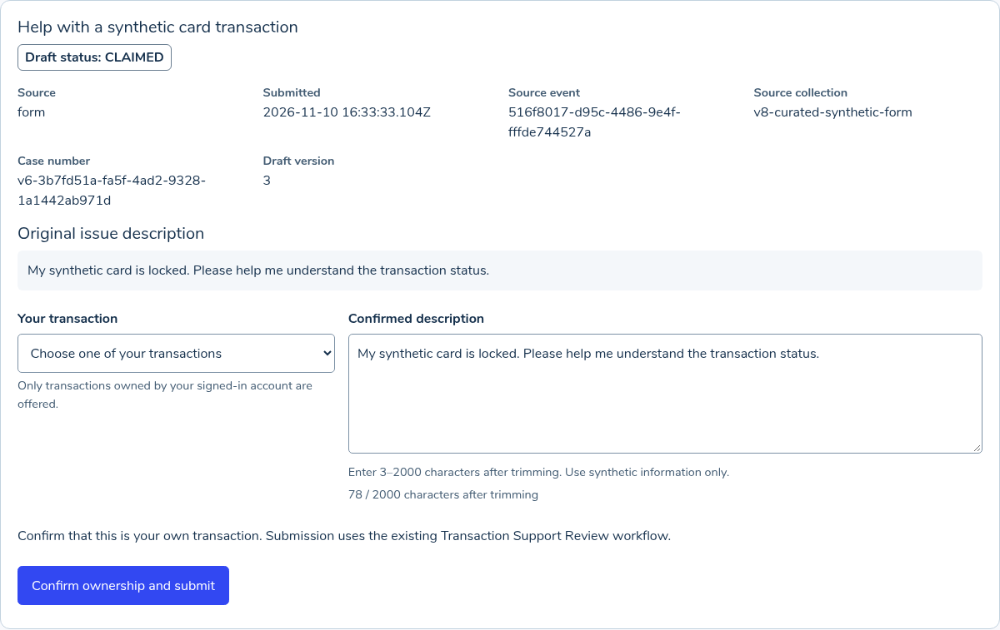
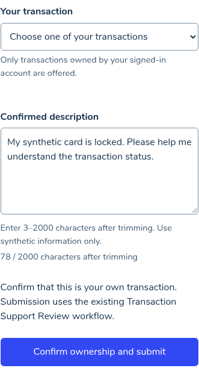
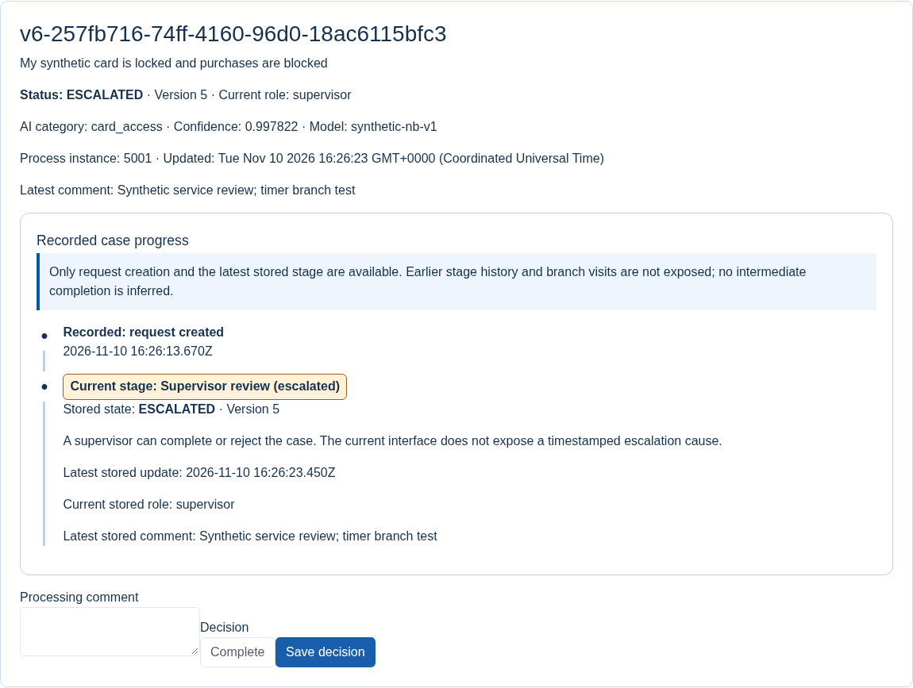
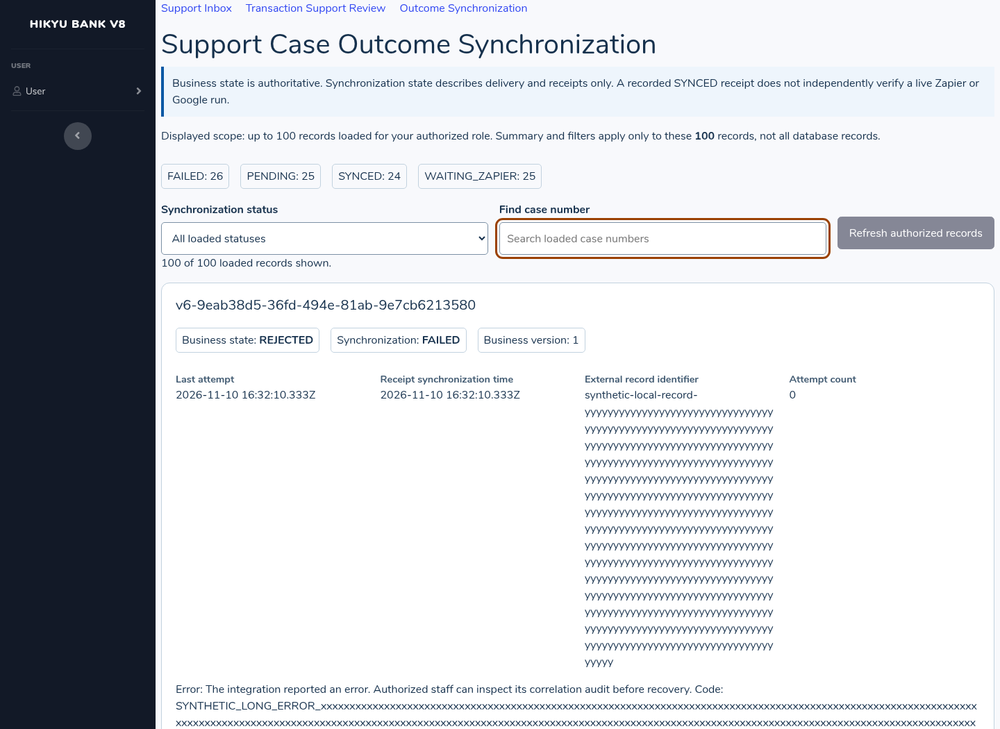

# Hikyu Bank V8 — Generative AI Prompt Engineering

Date: November 10, 2026. This increment uses the newly uploaded `Hikyu_Bank_V7.zip` and the repository's current source. The upload's 315 files matched the repository baseline, commit `f1271f24330cf8aad0fe5f8dc43834ea49d3800a`, byte for byte. Work was isolated on `feature/v8-prompt-engineering-ui`; no earlier deployment, credentials or claimed completion was reused. Historical V7 evidence remains historical. Real Zapier/Google execution remains unverified.

## 1. Inspect the application and choose components

The verified application is Saltcorn 1.6.2 with PostgreSQL and a Flowable Transaction Support Review service. The existing support Inbox and synchronization views are implemented in `implementation/v7/plugin.cjs`. The support-review page is actually in `implementation/saltcorn/hikyu-plugin/index.js`; `banking-view.js` implements financial pages and was not replaced with a support component.

Three suitable enhancements were identified:

| Component | Verified starting point | V8 enhancement |
|---|---|---|
| Support draft confirmation | Assigned/claimed native drafts, own-transaction query, versioned submission | Readable source metadata; responsive fields; explicit transaction choice; trimmed 3–2000-character validation; retained input/error feedback; pending-click protection and keyboard focus |
| Recorded case progress | Persisted current stage, sequence, creation/update timestamps and latest comment; no exposed stage history | Honest recorded observations/current-stage view, branch-specific explanations, neutral unknown states and explicit missing-history disclosure |
| Outcome synchronization | Authorized loaded rows capped at 100, independent business/sync states, staff replay and audit | Loaded-scope counts/filter/search, refresh/replay feedback and race control, long-content layout and receipt-provenance disclosure |

The business workflow, PostgreSQL financial logic and BPMN definition are retained. No V8 business-schema migration was added. Native CSRF, role/record scope, transaction ownership, idempotency, frozen retry details and optimistic versions remain enforced on the server.

## 2. Write structured prompts and generate code

Three source-grounded initial prompts were saved before generation. They specify the actual CommonJS modules, Saltcorn view names, POST input/result contracts, roles, valid states, data limitations and acceptance criteria. They explicitly prohibit new frameworks, unsafe HTML, fabricated history, financial mutations and false live-integration claims. The prompts and generated snapshots have timestamps and SHA-256 manifests under `implementation/v8/prompts/`.

The generator was the coding assistant in this conversation. There was no separate model API call and no Zapier AI builder or new runtime generative AI feature. The existing runtime classifier is separate. The log records the task prompts used for code generation, not hidden reasoning or a fabricated external transcript.

The generated code uses dependency-free HTML, scoped CSS and delegated JavaScript. It reuses the existing stack and test dependency. The first output was preserved before review in `generated/round-1`; subsequent prompted outputs are preserved in rounds 2 and 3. `V8_Prompt_Log.md` contains the exact prompts, evidence links, integration mapping and revision history.

## 3. Integrate with the existing application

### Use case 1 — Support Inbox

The existing native Inbox calls `ui/inbox.cjs` through the original view. Draft cards identify source collection/event, subject, source time, status/version, original description and case number. The only offered transactions still come from the authenticated owner's query. The new placeholder requires an explicit selection.

Description counting and validation use `trim().length`, the same JavaScript UTF-16 string-length convention as the existing server. The minimum is 3 and maximum is 2000. Native maxlength remains a first guard; a programmatic overlength is independently rejected. Labels, descriptions and errors are associated by unique IDs. Frozen failed-submission details remain constrained by the existing adapter.

The controller sends the original CSRF field and version in the existing native POST. It disables controls during processing, blocks a duplicate event, preserves input after network/non-2xx responses, and refreshes only the affected card after confirmed success. It recognizes Saltcorn's CSRF/session redirects without treating the final HTML 200 as an accepted action. Keyboard focus moves into the updated card without stealing focus from another form.

### Use case 2 — Recorded progress

The current workflow API exposes only the current projection; it does not expose reliable per-stage history. V8 therefore displays only sourced observations: a creation timestamp when available and the latest stored state/version/update/current role/comment. If creation time is missing or invalid, only the current stored observation is shown. Complete history is explicitly marked unavailable.

The renderer handles SUBMITTED, MANUAL_TRIAGE, SERVICE_REVIEW, RETURNED, REVIEWER_REVIEW, ESCALATED, COMPLETED and REJECTED. Each state explains applicable alternatives. It does not draw agent, requester, reviewer and supervisor branches as mandatory sequential steps. Unknown states remain neutral and explicitly cannot confirm completion. Text accompanies visual styles; missing times never become an epoch or invented transition time. Original role-filtered queries and submit/decision forms remain in place.

### Use case 3 — Synchronization monitor

The monitor separates persisted business state from external synchronization state. Summary, status filtering and case search operate on at most 100 loaded authorized rows. The visible text states this scope; it never labels these counts whole-database totals. Existing staff-wide outbox totals have a separate explicit label. Empty filtered results are announced.

Cards show attempt and receipt times, business version, external identifier and readable error context. Staff-only replay still calls the original protected backend. Pending replay blocks repeated clicks; failures and denials are handled. Manual refresh preserves filters/focus, has a timeout, and can be canceled when a newer replay starts. A delayed older GET cannot overwrite the newer persisted result. There is no polling.

V7 receipts do not persist independently verified execution origin. V8 keeps raw SYNCED for compatibility but explains that it records a matching receipt, not independently proven live Zapier/Google execution. This warning remains even when the local-emulator URL is no longer configured; a configured emulator also receives a prominent warning. No historical emulator success was relabelled as a live platform success.

### Integration and startup adjustments

The repository's existing source tree is updated incrementally at `deliverables/hikyu-v7/source`; the V7 directory name is retained to preserve history and avoid duplicating an application. The original V7 ZIP is unchanged. V8 modules and documents have explicit V8 paths/names.

An isolated V8 setup uses new private configuration, a path-specific Docker project, a fresh database and new synthetic credentials. Defaults are loopback Saltcorn 8297, Flowable 8296 and PostgreSQL 55586. Runtime paths now resolve from the installation rather than a previous workspace. Saltcorn copies local plugin modules during installation, so the small copied entry modules use the generated source-root environment value to reach the actual helpers. Existing financial-page changes are limited to this path resolution.

The setup no longer rewrites tracked source paths and probes native schema existence before initialization. Generated service/proxy scripts remain private. After native view migration it restarts only its own Saltcorn instance to refresh cached metadata. A missing favicon was resolved with a real local SVG served by a read-only plugin route; console errors were not hidden. No secrets, database contents or installed dependencies belong in delivery.

## 4. Test, iterate and verify

The initial unit run passed 13 tests. Initial integration attempts exposed deployment/setup issues, including native view-cache refresh and plugin-copy path behavior; these were corrected and recorded separately from UI model quality. An early browser CSRF assertion incorrectly expected 403, while installed Saltcorn redirects invalid forms. Inspection and an actual no-mutation test corrected the test's expectation. A repeated-fixture locator was also made deterministic.

Actual boundary checks then found lost keyboard focus after successful card replacement. The follow-up prompt added context-aware focus movement. Code review also tightened missing-history display to current-stage-only. An additional round was required because disabling the monitor refresh button erased focus before it was captured. The third prompt revision captures focus before disabling, prefers newer intentional focus, and avoids taking focus outside the view.

Final verified results:

| Check | Actual result and scope |
|---|---|
| V8 pure rendering/state/unit suite | 14 Pass |
| V8 actual local browser suite | 18 Pass, 0 Fail; desktop/mobile, input, failures, repeat binding, filtering, race and permissions |
| Actual Flowable branch/browser checks | 2 Pass: malformed classifier output -> manual triage; controlled PT2S review timer -> supervisor -> completion |
| Related native support regression | 8 Pass; real local Saltcorn/Flowable/classifier, one operator simulating roles |
| Related workflow HTTP regression | 9 Pass |
| Related V7 integration regression | 17 Pass; explicitly emulated Google relay contract, not cloud execution |
| Fresh Flowable engine build tests | 6 Pass during independent setup |
| Retained private Zap configuration | Local structural validation Pass; no live Zap execution |

These suites overlap and are not presented as a total number of distinct business scenarios. Both account/balance and transaction snapshots were unchanged by the support tests. Actual browser tests reported no unhandled JavaScript errors; console errors from deliberate 403/409/500/503 fault tests are distinguished from unexpected errors. After the icon correction, repeat-navigation checks found no unexpected console error.

Display-only state/sync fixtures are labelled as such and held from outbound transport. They demonstrate rendering and authorization, not that Flowable executed every fixture. Real return/rejection and the manual/timer branches have separate actual engine evidence. The normal completion route is also covered by the retained native regression.

Figure 1. Actual final local Inbox card with synthetic data and native ownership confirmation fields.

Figure 2. Actual final form at a 375px viewport, with associated labels and length feedback.

Figure 3. Actual Flowable timer escalation shown in the native progress component. The PT2S test setting is restored to normal PT24H after the test. The UI does not invent previous-stage timestamps.

Figure 4. Actual local monitor containing explicitly synthetic display fixtures. Recorded receipt statuses are not live Zapier/Google proof.

Full procedures, actual outcomes, iteration failures and limits are in `V8_Test_Results.md`. Packaging provenance records the source commit, included-file hashes, ZIP CRC and changed/deleted file list. A full pack and a clearly labelled changes-only pack are generated from verified Git content; old archives, credentials, private data, dependencies and build caches are excluded.

## 5. Reflect on prompt engineering

`V8_Reflection.md` answers how prompt engineering affected code quality and workflow. It contains 100–200 English words. The owner supplied the reflection topic but not an original page proving the word/character unit; the chosen English-word constraint is explicit and does not carry forward V7's unlimited length.

Prompts improved compatibility by naming existing contracts and protection boundaries before generation. Browser evidence, rather than model confidence, determined subsequent changes. The focus defect required two revisions; no accuracy percentage, performance improvement or team experience is invented.

## Remaining boundaries

Real Zapier/Google end-to-end execution remains Not tested/Blocked as in V7. V8 adds no external deployment claim. Original V8 assignment-page wording was not independently retrieved. GitHub API access for PR creation/merge is evaluated separately from working Git transport; the final delivery provenance and handoff identify the actual PR and merge disposition. Creating a branch or comparison link is never reported as a merged PR.
